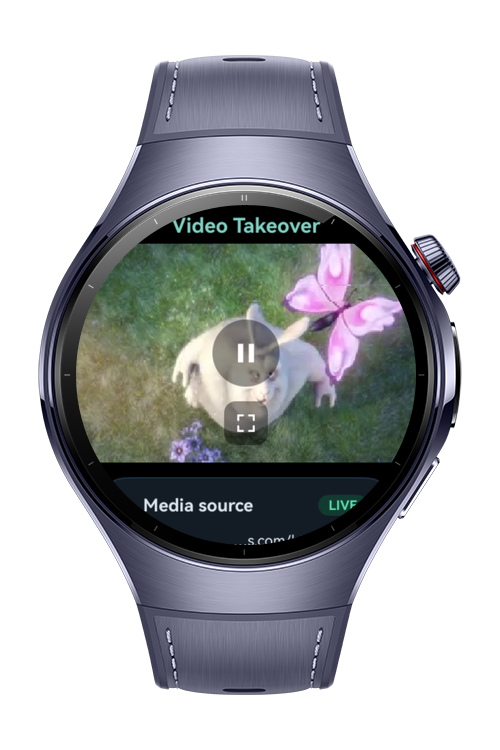
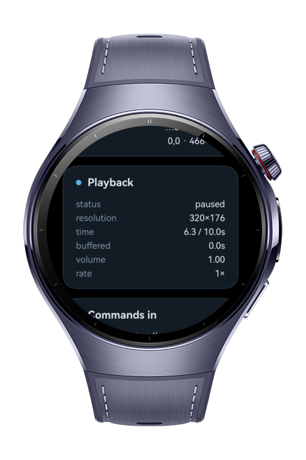
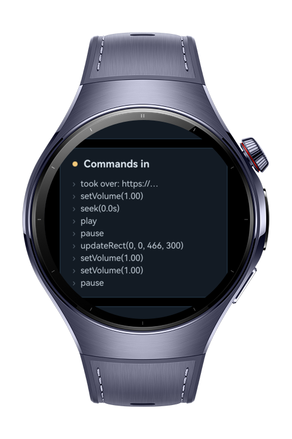
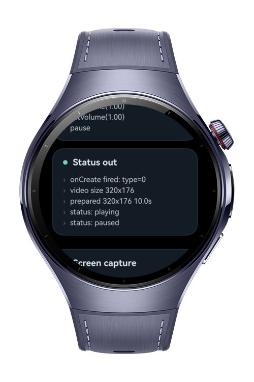

> **Note:** To access all shared projects, get information about environment setup, and view other guides, please visit [Explore-In-HMOS Index](https://github.com/Explore-In-HMOS/hmos-index).

# How To Build Native Media Player

**How To Build Native Media Player** (`how_to_build_native_media_player`) is a HarmonyOS wearable app that demonstrates how an app can take over an HTML `<video>` element's playback with its own native `AVPlayer`, using the ArkWeb native media player APIs (`enableNativeMediaPlayer`, `onCreateNativeMediaPlayer`, `NativeMediaPlayerBridge`, `NativeMediaPlayerHandler`, `NativeMediaPlayerSurfaceInfo`, and `MediaSourceInfo`) together with same-layer surface rendering via `BuilderNode` and an `XComponent`.

When the embedded web page begins loading, the app registers a takeover factory. ArkWeb then hands off each `<video>` to a native `AVPlayer` that renders onto the ArkWeb-provided surface, while ArkWeb keeps driving the web page and forwards every command (play, pause, seek, volume, mute, playback rate, rect updates, fullscreen, release). The app mirrors these commands and reports status, time, duration, and lifecycle back to the page, and exposes the whole exchange on a live status panel. It also shows app-driven immersive fullscreen through `FullScreenExitHandler` and a grant/deny `ScreenCaptureHandler` handshake.

# Preview

<div>
  
  
  
  
</div>

# Use Cases

- **Native video takeover**: Replace an HTML `<video>` with a native `AVPlayer` via `enableNativeMediaPlayer` and `onCreateNativeMediaPlayer`.
- **Command bridge**: Implement `NativeMediaPlayerBridge` so ArkWeb can drive play, pause, seek, volume, mute, playback rate, rect updates, and release.
- **Status reporting**: Push playback status, current time, duration, mute, and rate back to the page through `NativeMediaPlayerHandler`.
- **Same-layer surface rendering**: Render the `AVPlayer` output onto the ArkWeb surface with a `BuilderNode`-hosted `XComponent` using texture render type.
- **Media source inspection**: Read source, type, and format from `MediaSourceInfo` in `mediaInfo.mediaSrcList`.
- **App-driven fullscreen**: Enter and exit immersive fullscreen using `FullScreenExitHandler` from `onFullScreenEnter` / `onFullScreenExit`.
- **Screen capture handshake**: Grant or deny a web screen-capture request through `ScreenCaptureHandler` and `onScreenCaptureRequest`.

# Technology

## Stack

- **Languages**: ArkTS / ArkUI
- **Frameworks**: HarmonyOS SDK 6.0.1(21)
- **Tools**: DevEco Studio 6.x+
- **Libraries**:
  - `@kit.ArkWeb`
  - `@kit.ArkUI`
  - `@kit.MediaKit`

## Required Permissions

| Permission | Reason |
|---|---|
| `ohos.permission.INTERNET` | Stream the public HTTPS MP4 media source loaded by the embedded web page. |
| `ohos.permission.MICROPHONE` | Support the web screen-capture request handshake exposed through `ScreenCaptureHandler`. |

# Directory Structure

```
entry/src/main/ets/
|---components
|   |---StatusPanel.ets          // live observability panel: media source, playback, commands-in, status-out
|---entryability
|   |---EntryAbility.ets
|---pages
|   |---VideoLesson.ets          // single @Entry page: Web + takeover registration, fullscreen, screen capture
|---player
|   |---PlayerState.ets          // @Observed shared state
|   |---VideoBridge.ets          // implements NativeMediaPlayerBridge, mirrors state to PlayerState + handler
|   |---VideoSurfaceController.ets // NodeController/BuilderNode hosting the XComponent surface
|   |---VideoTakeoverPlayer.ets  // AVPlayer wrapper (surface-deferred prepare)
```

The web driver page lives in `entry/src/main/resources/rawfile/video.html`; it contains the `<video>` element plus play/pause and fullscreen buttons that ArkWeb hands off to the native player.

# Constraints and Restrictions

## Supported Devices

- Huawei Watch 5
- DevEco Studio wearable simulator

Note: the media source is a public HTTPS MP4, so an active network connection is required. Screen capture on the wearable emulator is handshake-only (grant/deny is exercised, but actual frame capture is device-only).

# License

**How To Build Native Media Player** is distributed under the terms of the MIT License.
See the [LICENSE](/LICENSE) for more information.
